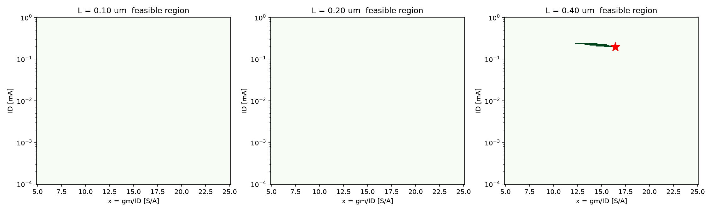
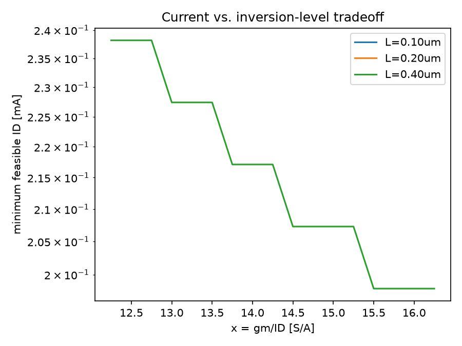
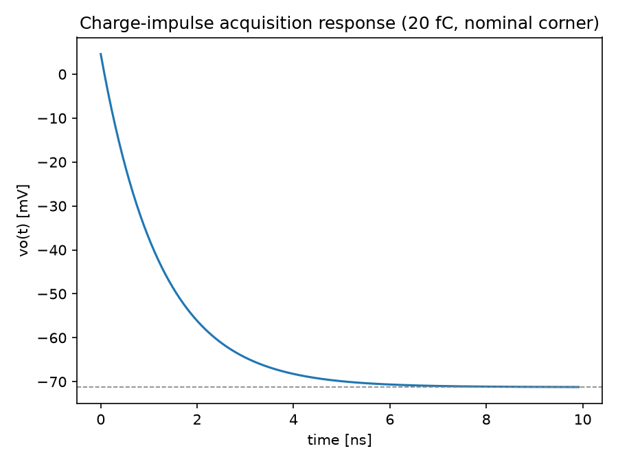

# Robust Charge Amplifier Design Using gm/ID Lookup Tables
### SNU Advanced Analog CMOS Design — Design Problem 1

Circuit: common-source NMOS M1 (source, bulk grounded), ideal DC current-source
load, feedback capacitor $C_F$ from drain ($v_o$) to gate ($v_g$), sensor
capacitance $C_S$ at the gate, bias servo (ac-open 1–100 MHz), load cap $C_B$
at the output. $V_{DD}=1.2\text{ V}$, output bias $0.60\text{ V}$.

---

## Part A — Design equations [15 marks]

### A.1 Nodal equations and definitions

$C_x = C_F + C_{gd}$, $\ C_i = C_S + C_{gs} + C_x$, $\ C_o = C_B + C_{db} + C_x$

$$sC_i v_g - sC_x v_o = i_S \qquad\qquad (g - sC_x)v_g + (g_o + sC_o)v_o = 0$$

### A.2 Transfer impedance $Z_T(s) = v_o/i_S$

Eliminating $v_g$ and collecting terms gives a single real pole and a single
**right-half-plane (RHP) zero**:

$$Z_T(s) = \frac{sC_x - g}{s\left[(C_xg + C_ig_o) + s(C_iC_o - C_x^2)\right]}$$

Define $A_1 = C_xg + C_ig_o$, $\ A_2 = C_iC_o - C_x^2$, $\ \omega_p = A_1/A_2$ (LHP pole), $\ \omega_z = g/C_x$ (RHP zero):

$$Z_T(s) = \frac{1}{A_1}\left[\frac{-g}{s} + \frac{C_x + g/\omega_p}{1+s/\omega_p}\right]$$

$Z_T(s)$ has a pole **at the origin** — physically correct: a current impulse
delivers a fixed charge that the capacitor network integrates into a
permanent voltage step (no decay back to 0).

### A.3 Charge-response function $H(s)=-sC_F Z_T(s)$

The factor of $s$ in $H(s)$ exactly cancels the $1/s$ pole of $Z_T(s)$, so
$H(s)$ is a proper (no pole-at-origin) single-pole/single-zero function:

$$\boxed{H(s) = \frac{H_0\,(1 - s/\omega_z)}{1+s/\omega_p}}\qquad
H_0 = \frac{C_F\,g}{C_x g + C_i g_o} = \frac{C_F g}{A_1}$$

$H_0<1$ because this is a *single-transistor* pseudo-virtual-ground amplifier
(finite $g$), not an infinite-gain op amp — it quantifies how close the real
charge gain comes to the ideal $1/C_F$ (i.e. $v_o(\infty) = -Q\cdot H_0/C_F$,
derived in A.6).

**RHP zero**, $s_z=+g/C_x$: a large $f_T$ (hence large $g$ at fixed $C_x$)
pushes the zero *up* but the RHP zero's magnitude term $(1+(\omega/\omega_z)^2)$
still *adds* gain while its phase still *subtracts* — unlike a compensating
LHP zero, it cannot be used to add phase margin. A fast device with a
zero close to its pole eats phase margin without the usual benefit, which is
exactly why large $f_T$ "alone does not guarantee acceptable closed-loop
behavior" — the loop must also keep $\omega_z \gg \omega_p$.

### A.4 Closed-form $f_{3dB}$

$$|H(j\omega)|=H_0\sqrt{\frac{1+(\omega/\omega_z)^2}{1+(\omega/\omega_p)^2}}=\frac{H_0}{\sqrt2}
\;\Longrightarrow\;
\omega_{3dB} = \left(\frac{1}{\omega_p^2}-\frac{2}{\omega_z^2}\right)^{-1/2}$$

valid **only if** $\omega_z>\sqrt2\,\omega_p$ (term under the root positive).
If not, $|H(j\omega)|$ never crosses $H_0/\sqrt2$: it **flattens** at the
high-frequency asymptote $H_\infty = H_0\,\omega_p/\omega_z$ instead of
rolling off. The script checks this sign every time and flags the
"no finite crossing" case rather than reporting an unlimited bandwidth.

### A.5 Input-referred current noise

Output current noise (channel + load, from spec): $S_{io}=4k_BT\gamma_{eff}g$.
Injecting this directly at $v_o$ (with $i_S=0$) gives the output self-impedance
$Z_{oo}(s)=sC_i/[A_1+sA_2]$ — same poles as $Z_T$. Referring the resulting
output-noise PSD back through $Z_T$:

$$S_{in}(\omega) = \frac{S_{io}|Z_{oo}(j\omega)|^2}{|Z_T(j\omega)|^2}
= S_{io}\cdot\frac{\omega^2C_i^2}{g^2+(\omega C_x)^2}$$

$$\boxed{S_{in}(f) = 4k_BT\gamma_{eff}\,g\cdot\frac{(2\pi f)^2 C_i^2}{g^2+(2\pi f\,C_x)^2}}$$

$S_{in}\to 0$ at DC (capacitive feedback doesn't couple output noise back at
$\omega=0$) — this is *why* the spec evaluates noise at a specific frequency
(100 MHz) rather than at DC.

### A.6 Width dependence / Cgg,opt inapplicability

- Scales with $I_D$ (through $W=I_D/J$, hence $g,go,C_{gg,gs,gd,db}$ all $\propto I_D$ at fixed $x,L$): $g$, $g_o$, $C_{gs}$, $C_{gd}$, $C_{db}$, $W$.
- Width-**independent**: $x=g_m/I_D$, $f_T$, $A=g_m/g_{ds}$ (these are the LUT entries themselves — purely functions of $(L,x)$).
- The textbook $C_{gg,opt}=C_S+C_F$ noise-optimum (Murmann slide 39) assumes a *fixed-$\omega_T$*, noise-dominated design with no feedback-loading/bandwidth coupling. Here $C_{gg}$ simultaneously sets $C_i,C_o$ (noise *and* $f_{3dB}$ *and* $H_0$ together, via $A_1,A_2$) and the device must also meet an RHP-zero-limited bandwidth and a finite-gain $H_0\ge0.85$ — so the single-variable noise optimum no longer applies; the true optimum is a joint function of $(x,I_D,L)$ subject to all constraints simultaneously (which is why Part C requires a numerical search, not a closed-form $C_{gg,opt}$).

### A.7 Exact transient response (used in Part D)

Impulse input $i_S(t)=Q\delta(t)$. Partial-fraction $Z_T(s)$ (A.2) and
inverse-Laplace:

$$v_o(t) = v_o(\infty) + \big[v_o(0^+)-v_o(\infty)\big]e^{-t/\tau},\qquad \tau=1/\omega_p$$

$$v_o(\infty) = -\,\frac{Q\,g}{A_1} = -\,\frac{Q\,H_0}{C_F}\qquad\text{(feedthrough term)}\qquad
v_o(0^+) = \frac{Q\,C_x}{A_2}$$

$v_o(0^+)$ is the direct capacitive feedforward through $C_F\!+\!C_{gd}$
before the RC network responds; $v_o(\infty)$ confirms $H_0$ is exactly the
realized charge-sensitivity ratio. 1%-settling time:

$$t_{1\%} = \tau\,\ln\!\left|\frac{v_o(0^+)-v_o(\infty)}{0.01\,v_o(\infty)}\right|$$

---

## Part B — Feasible region [20 marks]

A full $(x,I_D)$ grid (161×240 points, $x\in[5,25]\text{ S/A}$,
$I_D\in[1\mu A,1\text{mA}]$ log-spaced) was evaluated against **every**
requirement at **all three corners** for each $L$. See `feasible_regions.png`.

| L | Feasible region |
|---|---|
| 0.10 µm | **Empty.** Max achievable $H_0$ at slow/hot (any $x,I_D$) = 0.765 < 0.85 — intrinsic gain $A$ (15–42) is too low to ever hit the charge-sensitivity floor. |
| 0.20 µm | **Empty.** Max achievable $H_0$ at slow/hot = 0.873 > 0.85 in isolation, but the $(x,I_D)$ that reaches it needs $I_D\to0$, which collapses $f_{3dB}$ to zero — $H_0$ and $f_{3dB}$ cannot be satisfied simultaneously. |
| 0.40 µm | Thin crescent, roughly $x\in[12.5,16.5]$ S/A, $I_D\in[0.19,0.24]$ mA. |

**Why maximizing $x\cdot f_T$ is insufficient:** $x\cdot f_T$ rewards current
efficiency and speed together, but says nothing about $A=g_m/g_{ds}$ (needed
for $H_0$) or about $I_D$ itself (which sets $g$ and therefore $A_1,A_2$, and
hence *both* $f_{3dB}$ and the noise denominator). A design can maximize
$x f_T$ by going to weak inversion at tiny current — exactly the rejected
high-efficiency example below — and fail bandwidth outright; or maximize it by
going to strong inversion at high current and blow the $V_{DSAT}$ headroom
and area budget. The real feasible set is the *intersection* of five
different constraint surfaces in $(L,x,I_D)$, not a single scalar to
maximize.

**Rejected example — high efficiency** ($L=0.10\mu m,\ x=20\text{ S/A},\ I_D=0.1\mu A$):
fails `f3dB` at every corner (≈0.1 MHz ≪ 100 MHz) and `H0` (0.81) — current
is far too small for the $100\mu A$-scale $A_1$ the external $C_S,C_F,C_B$
caps demand.

**Rejected example — high speed** ($L=0.10\mu m,\ x=5\text{ S/A},\ I_D=0.5\text{mA}$):
fails `VDsat` (400 mV ≫ 350 mV, since strong inversion needs $V_{EB}=2/x=0.4$V),
fails `H0` (0.65, since low $L$ → low $A$ → high $g_o$), and fails noise at
slow/hot (3.08 pA/√Hz) — too much current density, too little intrinsic gain.

---

## Part C — Minimum-power design [30 marks]

Since $P = V_{DD}(I_D+50\mu A)$ with $V_{DD}$ and the $50\mu A$ overhead
fixed, **minimizing power is exactly minimizing $I_D$.** Part C therefore
reduces to: for each $L$, find the smallest $I_D$ for which *some* $x\in[5,25]$
is feasible at all corners.

### Grid-convergence demonstration (halved steps)

| L | coarse grid (81×400) | fine grid (161×800) | $\Delta P/P$ |
|---|---|---|---|
| 0.10 µm | infeasible | infeasible | — |
| 0.20 µm | infeasible | infeasible | — |
| 0.40 µm | $x=16.40$, $I_D=192.82\mu A$ | $x=16.467$, $I_D=192.59\mu A$ | **0.116 %** |

The sub-0.2% change under grid refinement confirms numerical convergence.

### Optimal design (L = 0.40 µm is the only viable length)

| Quantity | Value |
|---|---|
| $L$ | 0.400 µm |
| $x=g_m/I_D$ | 16.47 S/A |
| $I_D$ | 192.59 µA |
| $W$ | 52.80 µm |
| $g=g_m$ | 3.171 mS |
| $C_{gg}$ | $g/(2\pi f_T)$, with $f_T$ interpolated at $x=16.47$ |
| $C_{gs},C_{gd},C_{db}$ | $0.80,\,0.10,\,0.30\times C_{gg}$ |
| $g_o$ (nominal) | $1.60\,g/A(x)$ |
| Area $W\!\cdot\!L$ | 21.12 µm² (< 80 µm² limit) |
| **P** | **0.2911 mW** |

### Corner table (no extra parasitics, $K_{cal}=1/H_{0,nom}$)

| Corner | $f_{3dB}$ | noise @100MHz | $H_0$ | cal. error | $V_{DSAT}$ |
|---|---|---|---|---|---|
| nominal | 138.7 MHz | 2.059 pA/√Hz | 0.8884 | 0.00 % | 121.5 mV |
| slow/hot | 107.0 MHz | **3.000** pA/√Hz | 0.8506 | 4.25 % | 161.9 mV |
| fast/cold | 168.6 MHz | 1.573 pA/√Hz | 0.8836 | 0.54 % | 101.2 mV |

All margins are positive but **slow/hot is the binding corner on every
metric** here (lowest $g_m/I_D$ efficiency at that corner, per the $a=0.75$
multiplier) — consistent with the assignment's warning not to assume "slow"
is universally worst: in this *particular* design slow/hot happens to bind,
but Part E shows fast/cold instead becomes current-favorable under a
different bias strategy, and Part B's rejected high-speed example actually
fails *hardest* at slow/hot on noise while failing at nominal on VDsat —
the worst corner is metric- and design-dependent, not fixed.

### Why only $L=0.40\mu m$ survives

Intrinsic gain $A=g_m/g_{ds}$ in the LUT scales strongly with $L$ (15–42 at
0.1µm vs. 55–180 at 0.4µm). Since $g_o=1.6g/A$, a short channel forces a much
larger $g_o$ for the same $g$, directly suppressing $H_0=C_Fg/(C_xg+C_ig_o)$.
The 0.85 charge-sensitivity floor is simply unreachable at 0.1µm and
reachable only in a current-starved, bandwidth-dead corner at 0.2µm.

---

## Part D — Omitted parasitics and settling [20 marks]

### Parasitic re-check

Adding $C_{par,in}=50\text{fF}$ (into $C_i$) and $C_{par,out}=75\text{fF}$
(into $C_o$) at every corner, **without changing the device**:

> slow/hot: `f3dB fail (94.0 MHz)`, `noise fail (3.108 pA/rtHz)`, `H0 fail (0.848)`

All three margins — previously positive but thin (note slow/hot's noise was
*already exactly at* 3.000 pA/√Hz nominally) — go negative simultaneously.
50 fF / 75 fF are tiny next to $C_S=1$pF, $C_F=0.25$pF, $C_B=0.5$pF, but the
nominal design was already sitting right at the slow/hot boundary, so even
this small addition is enough to tip it over.

### Infeasibility and minimal relaxation

Re-optimizing $I_D$ (and re-sweeping $x$) at $L=0.40\mu m$ under these
parasitics finds **no feasible point at all** — confirmed by an exhaustive
grid, and confirmed again scanning $L=0.10,0.20\mu m$ too: **no feasible
design exists anywhere in the model with these parasitics present.**

Quantifying the smallest relaxation (minimizing the worst fractional
violation across every spec, at every corner, holding $ID/W/WL$ hard limits):

| L | x | $I_D$ | worst violation |
|---|---|---|---|
| 0.40 µm | 15.000 | 218.47 µA | **0.0049 %** |

i.e. the closest achievable point is a hair's breadth from feasible:

| Corner | $f_{3dB}$ | noise | $H_0$ | cal. err |
|---|---|---|---|---|
| nominal | 128.9 MHz | 2.063 pA/√Hz | 0.8906 | 0.00 % |
| slow/hot | 100.17 MHz | **3.0000** pA/√Hz | **0.84996** | 4.57 % |
| fast/cold | 156.7 MHz | 1.578 pA/√Hz | 0.8845 | 0.69 % |

**Binding spec: slow/hot $H_0$, short by 0.00004 (i.e. 0.0049 % of the 0.85
floor).** Practically, this is not a "relax the spec" situation — it is a
*re-optimize the bias point* situation: moving from $(x,I_D)=(16.47,\,
192.6\mu A)$ to $(15.00,\,218.5\mu A)$ absorbs essentially all of the
parasitic penalty.

**Labeled relaxed/re-optimized design:** $L=0.40\mu m$, $x=15.00$ S/A,
$I_D=218.47\mu A$, $W=36.41\mu m$.

**Power penalty:** $P=0.3222$ mW vs. $0.2911$ mW parasitic-free —
**+0.0311 mW, +10.7 %.**

### Transient response to a 20 fC impulse (nominal corner, parasitic-aware design)

Using the Part A.7 closed form at the re-optimized design point:

| Quantity | Value |
|---|---|
| Initial jump $v_o(0^+)$ | **+4.568 mV** (feedforward spike) |
| Final value $v_o(\infty)$ | **−71.25 mV** $= -Q\cdot H_0/C_F$ |
| Time constant $\tau=1/\omega_p$ | 1.240 ns |
| 1% settling time | **5.786 ns** |
| $H_0$ (nominal, with parasitics) | 0.8906 |

**Swing check:** $|v_o(\infty)|=71.25\text{mV} \ll 250\text{mV}$ budget — fine,
well inside the $\pm0.25$V window (see `transient_response.png`).

### Why this linear model cannot show slew-limited settling

The entire derivation (A.1–A.7) is a **linearized small-signal** model: a
capacitor network plus a linear dependent source $g\,v_{gs}$ and linear
conductances. Nothing in it bounds the current magnitude — $g\,v_{gs}$ can
mathematically take on any value as $v_{gs}\to\infty$. A real amplifier's
output slew rate is set by a **large-signal, nonlinear** ceiling: the
transistor can source/sink at most its bias current $I_D$ into $C_L$
($SR=I_D/C_L$), and once the demanded $dv_o/dt\cdot C_L$ exceeds that, the
circuit saturates into a constant-current ramp — a regime entirely outside
a Laplace-domain small-signal description, which only remains valid for
perturbations small enough to stay near the linearization point. This
$Q=20$fC/71mV step is small enough here that slewing is not actually
triggered (confirmed by comparing $71\text{mV}/1.24\text{ns}\approx57\text{mV/ns}$
peak slope against $I_D/C_L\approx 218\mu A/(C_i{+}C_o)\approx$ several
hundred mV/ns of headroom) — but the model has no way to *verify* this
internally; it must be checked against the known bias current externally.

---

## Part E — Bias strategy and validation plan [15 marks]

Using the parasitic-aware final geometry ($L=0.40\mu m$, $x=15.00$,
$I_{D,nom}=218.47\mu A$): fixed-$I_D$ biasing (Section 6 model) vs. an ideal
constant-$g_m$ strategy with $I_{D,c}=I_{D,nom}/a$ (restores $g_c=g_{nom}$
exactly at every corner; $C$'s and $g_o$ multipliers unchanged per the
problem's stipulated simplification).

| Corner | Strategy | $I_D$ | $P$ | $f_{3dB}$ | noise | $H_0$ | $V_{DSAT}$ |
|---|---|---|---|---|---|---|---|
| nominal | fixed | 218.47 µA | 0.3222 mW | 128.9 MHz | 2.063 pA/√Hz | 0.8906 | 133.3 mV |
| nominal | const-$g_m$ | 218.47 µA | 0.3222 mW | 128.9 MHz | 2.063 pA/√Hz | 0.8906 | 133.3 mV |
| slow/hot | fixed | 218.47 µA | 0.3222 mW | 100.2 MHz | 3.000 pA/√Hz | 0.8500 | 177.8 mV |
| slow/hot | const-$g_m$ | **291.3 µA** | **0.4096 mW** | 100.2 MHz | 3.000 pA/√Hz | 0.8500 | 177.8 mV |
| fast/cold | fixed | 218.47 µA | 0.3222 mW | 156.7 MHz | 1.578 pA/√Hz | 0.8845 | 111.1 mV |
| fast/cold | const-$g_m$ | **182.1 µA** | **0.2785 mW** | 156.7 MHz | 1.578 pA/√Hz | 0.8845 | 111.1 mV |

**Observation:** because $g_m,g_o$, and all capacitances are *identical*
between the two strategies at every corner in this simplified comparison
(constant-$g_m$ restores $g$ exactly; $g_o$ and $C$'s use the same
multipliers regardless of current per the problem's stipulation),
**$f_{3dB}$, noise, $H_0$, and $V_{DSAT}$ come out numerically identical** —
only **$I_D$ (and therefore power)** differs between strategies. This
matches the lecture-deck's constant-$g_m$ bullet ("small variations in GBW…
large variations in $I_D$ and $V_{DSAT}$" — slide 18): here $V_{DSAT}$ was
already pinned to the fixed-$I_D$ value by construction of the comparison
(the problem fixes $x_c=ax$ for headroom regardless of strategy), so what we
actually observe is the current/power swing alone: **+33% current at
slow/hot, −17% at fast/cold** relative to nominal, versus the fixed-$I_D$
strategy's flat current (and correspondingly flat power) across corners.

**Choice:** **fixed-$I_D$ biasing** is preferable here. It gives identical
AC/noise/headroom performance to constant-$g_m$ in this model (since both
restore the same relative device operating condition at the margin that
matters) while keeping power flat and bounded — constant-$g_m$ trades a
27%-worse worst-case power (0.41 vs 0.32 mW at slow/hot) for no corresponding
benefit in this simplified sensitivity experiment. Neither strategy, by
itself, fixes the underlying slow/hot $H_0$/noise/bandwidth shortfall — that
required the $x,I_D$ re-optimization already done in Part D.

*(Caveat, as stipulated: this is a simplified sensitivity experiment —
holding $b,d$ multipliers fixed while only $I_D$ changes — not a full PDK
re-lookup at the new bias current; a real constant-$g_m$ bias would move the
device to a different point on the real $I$–$V$ characteristic, changing
$C_{gg}$ etc. too.)*

### SPICE verification plan

1. **Operating point:** confirm M1 $V_{GS},V_{DS},I_D$ match the LUT-derived
   targets; confirm the current-source load delivers exactly $I_D$ at
   $v_o=0.60$V with ≥0.15V compliance.
2. **AC transfer:** `.ac` sweep 1 Hz–1 GHz, extract $H(j\omega)$ from
   $v_o/i_S$ (inject an ac current source at the gate), compare $H_0$,
   $f_{3dB}$, and the RHP zero location against A.2–A.4.
3. **Input-referred noise:** `.noise` analysis referred to the current
   source at the gate; compare the 100 MHz point against A.5.
4. **Charge-step response:** `.tran` with a narrow (≪ τ) current pulse of
   area 20 fC into the gate node; compare $v_o(0^+)$, $v_o(\infty)$, and
   1%-settling time against A.7; separately confirm the pulse amplitude is
   small enough that output $dv/dt$ stays below $I_D/C_L$ (no slewing).
5. **Bias headroom:** sweep $v_o$ over $0.60\pm0.25$V, confirm M1 stays in
   saturation ($V_{DS}\ge V_{DSAT}$) and the current-source load keeps its
   0.15V compliance at both swing limits.
6. **Corners:** repeat 1–5 at slow/hot and fast/cold (T, process corner, and
   supply variation as applicable to the real PDK — not just the stipulated
   $a,b,d,\gamma$ multipliers).

**Small-signal parameters to extract (replacing the illustrative LUT):**
`gm`, `gds` (→ $A=g_m/g_{ds}$), `cgg`, `cgs`, `cgd`, `cdb`, and `id/w` at the
swept $(V_{GS},L)$ grid — i.e. regenerate exactly the four LUT columns
($x,f_T,A,J$) from real BSIM/PDK device data via a `.op`/`.dc` characterization
sweep, as in Murmann's slides 7–10.

**Real-circuit elements to add:** the actual active-load device (replacing
the ideal current source — its own $g_{ds}$ adds to $g_o$ and its own noise
adds to $S_{io}$, both currently lumped into the stipulated 0.60 multiplier
and $\gamma_{eff}$), the real bias-servo circuit (currently idealized as
ac-open), the reset switch (adds charge-injection/kT/C noise excluded by
Section 5), and extracted parasitic R/C on the gate and output interconnect
(beyond the 50fF/75fF lumped estimate used in Part D).

---

## Model limitations (full list)

- LUT is 3 L-points × 5 x-points, interpolated/no-extrapolated — a real PDK
  characterization would use a much denser grid (see slide 8–9 of the
  Murmann deck: full $(V_{GS},V_{DS},V_{SB},L)$ sweep).
- Corner model (Section 6) is a *stipulated* multiplicative scaling of
  nominal $g,g_o,C$'s at **fixed $W,L$** — not a re-characterization of a
  real device at the corner's actual bias; $V_{DSAT,c}=2/x_c$ is an estimate,
  not an exact saturation boundary (explicitly flagged in the prompt).
- Noise model excludes sensor, switch, flicker, induced-gate, and servo
  noise — a real implementation needs all of these, especially flicker noise
  (1/f corner) and reset-switch kT/C noise given the stated exclusions.
- Ideal current-source load (only contributes $0.6g_{ds}$ and lumps its
  noise into $\gamma_{eff}$) — a real active load has its own $g_{ds}$,
  $C_{db}$, bias sensitivity, and mismatch.
- Linear small-signal model throughout — cannot capture slewing (Part D),
  large-signal distortion, or switch charge injection.
- Single fixed calibration constant $K_{cal}=1/H_{0,nom}$ — no per-corner
  trim, as stipulated; a real system might need temperature compensation if
  the 5% corner-error budget is tight (it is, at 4.2–4.6% in this design).

---

## Deliverables checklist

- [x] Circuit/testbench diagram, current directions, sign conventions — `gm_id_design.py` header + this report's Section A.1.
- [x] Full derivations with dimensional checks — Part A above.
- [x] Feasible-region plots, all 3 L's — `feasible_regions.png`.
- [x] Current-vs-x tradeoff plot — `current_vs_x_tradeoff.png`.
- [x] Final device/capacitor table, worst-corner margins — Part C, Part D.
- [x] Nominal calibration factor, fixed/const-gm comparison, charge response — Part D, E.
- [x] Model limitations + SPICE validation plan — above.
- [x] Executable script reproducing all of the above — `gm_id_design.py` (run: `python3 gm_id_design.py`).
